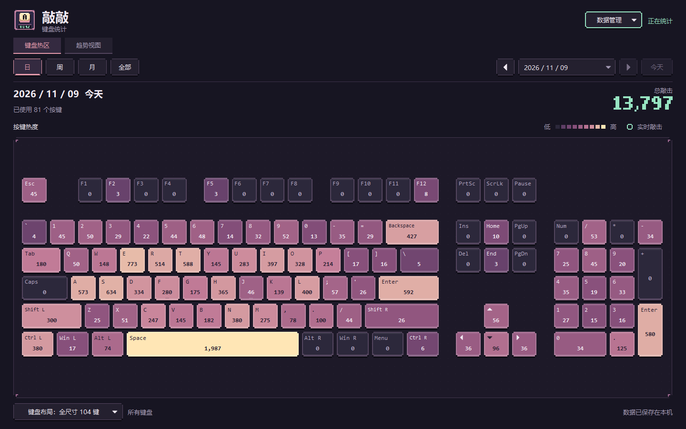
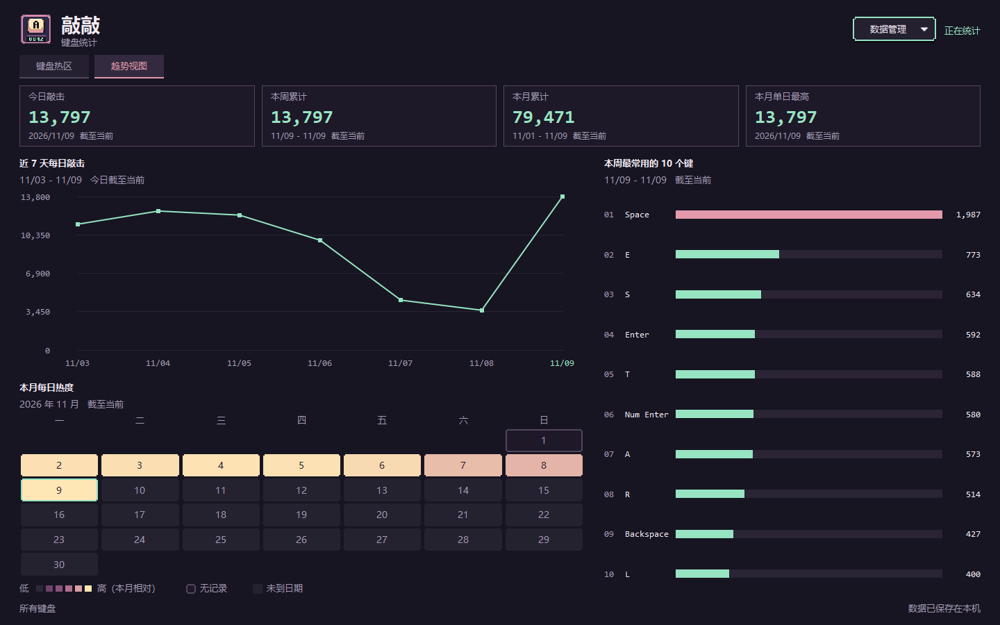
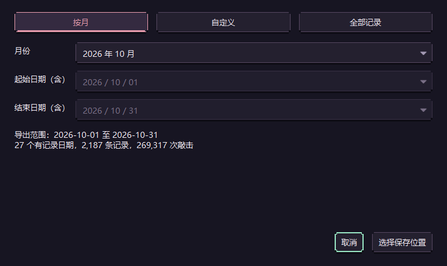
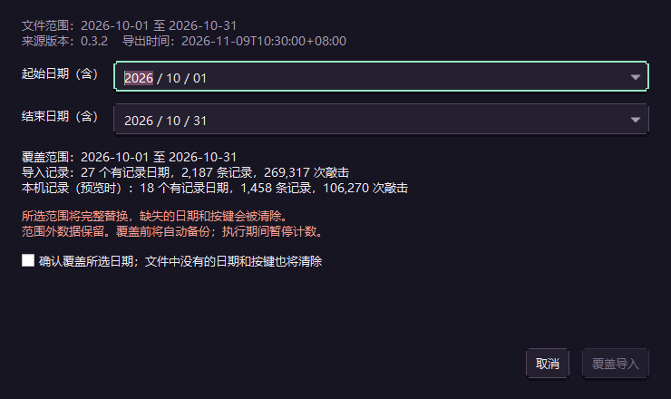

# 敲敲 · Qiaoqiao

**Windows 本地物理按键统计工具，用热区和趋势图看见每天的键盘使用习惯。**

敲敲在后台累计每个物理键的敲击次数，支持历史查询、六种键盘布局、趋势分析，以及按日期备份和恢复。
采用暗色像素风界面，无需账号，离线运行，统计数据保存在本机。
窗口保留 Windows 原生标题栏，并在系统支持时使用深色外观。



> 本文介绍当前源码已实现的功能。所有截图均为应用真实界面，使用合成数据，不包含个人使用记录。

## 功能一览

| 功能 | 说明 |
| --- | --- |
| 键盘热区 | 按键显示完整次数，以颜色呈现相对热度，敲击时提供短暂反馈 |
| 历史查询 | 支持日、周、月、全部累计，以及指定日期查询 |
| 趋势视图 | 四张数据卡片、近 7 天折线、本周热门按键排行、本月热力日历 |
| 六种布局 | 104 键、87 键、75%、65%、60% 和通用笔记本布局 |
| 后台统计 | 关闭或最小化主窗口后进入托盘，可显示动画桌面宠物，继续计数并自动保存 |
| 千次里程碑 | 当日累计达到新的整千次数时提醒，可在托盘菜单关闭 |
| 备份与恢复 | 按月、自定义日期或全部记录导出；按所选日期范围覆盖导入 |
| 本地存储 | 仅保存每日物理键聚合次数，不保存输入内容，不上传统计 |

## 开始使用

### 使用发布包

1. 获取 Windows x64 发布包并完整解压，保留随包提供的所有文件，尤其是 `_internal`。
2. 双击 `敲敲.exe`。右上角显示“正在统计”后即可正常使用键盘，无需安装 Python 或数据库。
3. 默认查看今天的“键盘热区”。点击“日 / 周 / 月 / 全部”切换范围，通过日期或左右箭头查看历史。
4. 切换到“趋势视图”查看近期变化；右上角“数据管理”提供导出和导入。
5. 需要停止统计时，在托盘图标的右键菜单中选择“退出程序”。

关闭或最小化主窗口会进入托盘，**不会退出程序**。单击或双击托盘图标可恢复窗口；
若找不到图标，请检查 Windows 任务栏的折叠托盘区域。重复启动同一数据实例会唤回已有窗口。

桌面宠物采用深色像素角色，默认在主窗口隐藏时显示，可拖动到桌面任意位置。
自由摆放时播放轻呼吸并偶尔眨眼，拖动时提起，松开后短暂回弹；
松开时靠近屏幕左右边缘会倾斜探出上半身，靠近顶部会悬挂，靠近任务栏上方会趴伏在可用区域底边。
双击宠物打开主界面，右键可打开菜单。
托盘及宠物菜单中的“显示宠物”“宠物顶置”开关会保存；顶置关闭后允许普通窗口覆盖宠物。
打开主窗口会暂时隐藏宠物，不改变“显示宠物”偏好；在托盘关闭“显示宠物”后仍会继续统计。
宠物隐藏时停止动画播放；当前尚无随敲击响应或里程碑庆祝动作。

发布包内的 `Create-Desktop-Shortcut.cmd` 可创建或更新桌面快捷方式。程序不会自动设置开机启动。
也可以按文末说明从源码运行或自行打包。

## 键盘热区与布局

每个键显示所选时段内的累计次数，颜色由紫、粉逐渐过渡到浅黄，越接近浅黄表示使用越多。
热度以当前布局中最常用的键为基准；薄荷绿边框表示实时敲击。悬停可查看键名和完整次数。

左下角“键盘布局”提供以下预设，选择会在下次启动时恢复：

| 布局 | 适用显示 |
| --- | --- |
| 全尺寸 104 键 | 完整主键区、功能区、导航区和数字小键盘 |
| 无数字区 87 键 | 保留功能区与导航区，不显示数字小键盘 |
| 75% 紧凑 84 键 | 保留 F 区，紧凑排列导航键和方向键 |
| 65% 紧凑 68 键 | 保留方向键和部分导航键，无独立 F 区 |
| 60% 迷你 61 键 | 紧凑主键区 |
| 笔记本（通用紧凑） | 紧凑 F 区与半高上下方向键 |

布局只改变显示，不改变采集和历史记录。总敲击包含所有按键；有记录但未显示在当前布局中的键，
会列在“布局外按键”中。预设是通用排列，不会自动识别键盘型号，也不按设备分别筛选。

## 趋势视图



| 图表 | 展示内容 |
| --- | --- |
| 顶部卡片 | 今日敲击、本周累计、本月累计、本月单日最高及对应日期 |
| 近 7 天每日敲击 | 包含今天的最近 7 个自然日，观察每天的使用变化 |
| 本周最常用的 10 个键 | 从本周一至今天，按次数排列的横向柱状图 |
| 本月每日热度 | 自然月日历，以颜色深浅表示每日敲击次数 |

趋势以电脑本地今天为基准，统计截至当前，包含所有物理键和尚未写入数据库的计数，
不受键盘热区所选日期或显示布局影响。

- 悬停折线或日历可查看日期和完整次数；点击日期可跳转到当天的键盘热区。
- 支持用方向键选择图表日期，再按 Enter 查看。
- 历史缺失日显示“无记录”，折线在此断开；不会将未运行程序的日期推断为零次。
- 今天尚无敲击时显示 0；未来日期置灰且不可跳转。
- 切换两个视图会保留键盘页的日期与布局，点击图表日期时才切换到指定日。

## 备份与换机恢复

从主窗口或托盘菜单打开“数据管理”，即可在原电脑导出，在新电脑导入。

### 导出数据



选择“导出数据”，按月、自定义起止日期或选择全部记录，再选择保存位置。
文件扩展名为 `.qiaoqiao.json`，可以自行保存或转移到另一台电脑。

- 起止日期均包含在范围内。历史月份包含整月，当月只到今天。
- “全部记录”使用最早至最晚有记录的日期。
- 导出包含开始写文件时尚未保存的内存统计，之后的新敲击继续计入本机。

### 导入数据



1. 选择“导入数据”，打开备份文件。
2. 核对文件日期、来源版本和记录摘要。可导入整个文件范围，也可缩小为其中一段日期。
3. 勾选覆盖确认，再点击“覆盖导入”。
4. 完成后，键盘热区和趋势视图会自动刷新。

**导入按日期范围完整替换，不累加、不合并。**

| 情况 | 导入结果 |
| --- | --- |
| 同一天同一个键，本机 100 次，文件中 50 次 | 以文件为准，变为 50 次 |
| 所选范围内，文件没有某天或某个键的记录 | 清除对应的本机原记录 |
| 本机记录位于所选范围之外 | 保持不变 |
| 所选范围没有任何导入记录 | 确认后清空该范围 |

例如，只导入 `2026-10-01` 至 `2026-10-31`，不会改变 9 月或 11 月的记录。
导入范围不能晚于本机今天。

覆盖前，程序会自动备份受影响范围的原记录，完成提示中可查看备份位置。
需要撤销时，通过同一导入入口恢复这份备份即可。自动备份仅包含受影响范围，不是全部历史；
备份失败会中止导入，数据库替换失败会回滚。

文件选择和预览期间继续统计；实际覆盖期间会短暂停止计数，期间敲击不补记。
导入今天的数据后，千次里程碑会重新建立基线，不补发历史提醒。

### 备份文件说明

备份采用 UTF-8 JSON，当前格式版本为 `1`，包含应用版本、导出时间、起止日期、
每日物理键计数和 SHA-256 校验和。布局偏好、提醒设置和设备信息不在备份中。

程序会在导入前检查格式、完整性、日期范围、重复记录及次数是否合法。
单文件上限为 64 MiB，超限时可缩小导出日期范围。校验和用于检查完整性，**备份文件未加密**。

## 统计规则与隐私

- **按物理键计数**：一次按下到松开只计一次，忽略长按重复；统计的是敲击次数，不是输入字数。
- **区分键位**：左右修饰键、主键区和数字小键盘分别统计；Num Lock 不改变小键盘的物理键标识。
- **多键盘合计**：不同设备的次数汇总显示，按住状态按设备区分。
- **按本地日期归属**：周为周一至周日，月为自然月。查询历史不会改变新敲击所属日期。
- **仅保存聚合数据**：日期、物理键标识、当天累计次数；不保存输入文字、按键顺序、逐次按键时间或应用名称。
- **离线运行**：无需账号，不上传统计，也不包含遥测。

统计自动保存在本机，重启后继续累计。正常退出前会保存剩余数据；
保存失败时保留程序和内存中的记录，提示重试。强制结束进程、断电或磁盘故障可能丢失尚未保存的最新一批数据。

目前仅支持 Windows x64。未向系统报告扫描码的 Fn 或厂商特殊键无法单独统计，
布局中的 Fn 仅作占位。千次里程碑通知受 Windows 通知设置和勿扰状态影响。

## 从源码运行

需要 Windows x64 和 64 位 Python 3.15。在仓库根目录执行以下 PowerShell 命令：

```powershell
py -3.15 -m venv .venv
.\.venv\Scripts\python.exe -m pip install -r requirements.txt
.\.venv\Scripts\python.exe run.py
```

环境准备好后，也可双击 `start.cmd`。源码默认使用开发模式，开发数据与发布版正式数据相互隔离。

技术栈为 **PySide6 / Qt Widgets + Windows Raw Input + SQLite**，图表使用 QPainter 绘制，
无需 Web 服务或第三方图表框架。依赖版本以仓库中的 `requirements.txt` 和 `requirements-build.txt` 为准。

### 测试

```powershell
.\.venv\Scripts\python.exe -m unittest discover -s tests -v
```

原生输入测试需要正常的 Windows 桌面会话，不能以 Qt `offscreen` 模式代替。
需要独立试用数据时可运行：

```powershell
.\.venv\Scripts\python.exe run.py --dev --data-dir .\work\acceptance
```

### 打包

双击 `build.cmd`，或在仓库根目录执行：

```powershell
powershell -NoProfile -ExecutionPolicy Bypass -File .\tools\build.ps1
```

构建使用独立环境，运行测试后生成 Windows x64 文件夹版程序包、源码快照和 SHA-256 校验文件，
产物写入仓库的 `releases/`。同版本产物不会被覆盖，构建不会自动替换已安装程序或正式数据。

升级时建议先导出全部记录，再从托盘正常退出旧版。将新版完整解压到独立文件夹后启动，
同一 Windows 用户下的正式版本会继续读取已有统计；跨电脑迁移请使用导入功能。

### 实机验收

<details>
<summary>展开硬件与后台行为检查清单</summary>

以下是建议检查项，不代表所有键盘型号均已通过实测。请使用独立测试数据，并尽量用鼠标切换界面。

1. 按住普通键两秒再松开，应只增加 1；再次敲击应继续正常累计。
2. 分别敲左右 Ctrl、Shift，以及主键区和小键盘 Enter，确认各自独立计数。
3. 切换 Num Lock 后敲同一个小键盘数字键，确认仍计入同一物理键位。
4. 关闭或最小化窗口后继续敲击，再从托盘恢复，确认次数增加。
5. 查看历史日期时敲击，再返回今天，确认新次数归属今天。
6. 正常退出并重启，确认已保存记录保留；重复启动应唤回已有窗口。
7. 检查实际键盘的 PrintScreen、Pause、Fn 组合，以及拔插、锁屏和休眠后的统计恢复。

</details>
